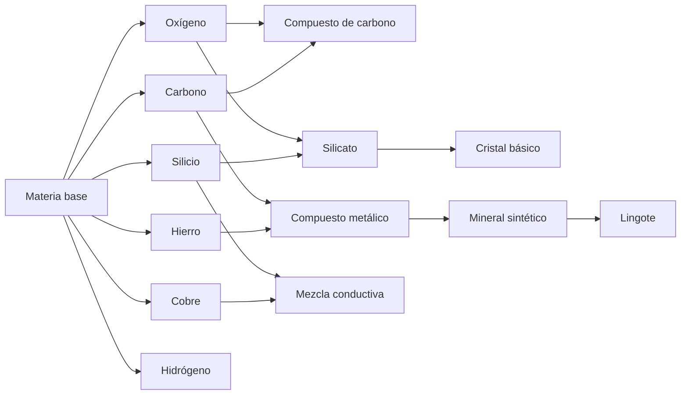

# Matterloom — revisión del árbol de producción

Fecha: 27 de octubre de 2026. Base: juego entregado 8.20.
Alcance aprobado: revisar las recetas existentes y dibujar el árbol para decidir
cómo ampliar la maquinaria. Este análisis no cambia el juego.

## Resultado

Los 14 recursos son alcanzables desde materia base y las 13 recetas tienen una
máquina asignada. No hay recetas huérfanas. Todas las transformaciones aumentan
el valor de venta frente a vender sus ingredientes por separado; ese aumento no
basta para afirmar que todas las líneas sean igual de rentables por tiempo o coste.

La estructura actual es una base útil, pero concentra el desarrollo en dos ramas:
cristales y lingotes. Las restantes ofrecen menos continuidad.

## Árbol actual

Cada combinación necesita TODOS sus ingredientes, una unidad de cada uno. Todos
los recursos se pueden vender. El árbol interactivo muestra maquinaria, nivel,
precio de construcción, intervalo nominal y valor de venta al seleccionar un nodo.

## Tres puntos de expansión claros

| Recurso | Estado actual | Dirección propuesta, aún no implementada |
|---|---|---|
| Hidrógeno | Se obtiene de materia base y se vende; no entra en otra receta | Usarlo junto a compuesto de carbono en un reactor químico para producir polímero |
| Compuesto de carbono | Producto final de carbono + oxígeno; sin uso posterior | Compartir la nueva rama química; luego servir para aislantes o carcasas |
| Mezcla conductiva | Producto final de cobre + silicio; sin uso posterior | Combinarla con cristal básico en una ensambladora para producir circuitos |

Cristal y lingote también son terminales hoy, pero ya tienen cadenas de varias
etapas. Que un material sea terminal no es un fallo: aquí se señalan oportunidades
de expansión, no recursos inútiles.

Las propuestas son recetas de juego simplificadas, no reacciones químicas reales.
No se han elegido todavía precios, tiempos ni niveles para los nuevos contenidos.

## Progresión actual

| Nivel | Ingresos acumulados necesarios | Producción disponible por primera vez |
|---|---:|---|
| 1 · Inicio | $0 | Receptor, carbono y venta |
| 2 · Procesamiento | $180 | Oxígeno |
| 3 · Síntesis | $650 | Silicio, cobre, hidrógeno y cámara de fusión |
| 4 · Industria | $1.800 | Hierro, sintetizador elemental y cristalizador |
| 5 · Tecnología avanzada | $4.000 | Formador mineral y fundidora |

Los ingresos son ventas históricas de la sesión: gastar dinero no baja el nivel.
Se puede llegar al nivel 5 vendiendo 500 unidades de carbono a $8, sin construir
una cadena avanzada. Mi recomendación es mantener los créditos como requisito de
compra y acompañar los desbloqueos con pequeños hitos de producción. Por ejemplo:
primera venta procesada, primera combinación y primer producto refinado. Deben
probarse antes de fijar cantidades para no convertirlos en tareas repetitivas.

El saldo inicial es $700. Receptor ($200), separador de carbono ($125), terminal
($100) y dos cintas ($20) suman $445; quedan $255 para ajustes. Es un ejemplo de
presupuesto, no una guía de colocación probada dentro de Studio.

## Balance: qué revisar antes de tocar cifras

- Fusionar silicio + oxígeno aumenta la venta de $22 a $26: +$4 por ciclo.
  El siguiente paso, cristalizar, eleva $26 a $55. Hay que evaluar la cadena
  completa; vender silicato no tiene el mismo atractivo que llegar al cristal.
- La ruta metálica pasa de hierro + carbono ($20) a compuesto ($30), mineral
  ($62) y lingote ($95). El rendimiento depende de alimentación, inversión y
  velocidad de cada etapa, no solo del precio final.
- Los intervalos nominales se revisan cada 0,6 segundos. En un reloj ideal,
  2,0 y 2,2 s se convierten en 2,4 s; 2,5–2,8 s en 3,0 s; 3,2 y 3,5 s en 3,6 s;
  4,0 s en 4,2 s. La ejecución real puede añadir retraso.
- Son intervalos desde la última producción, no un temporizador de trabajo
  iniciado al recibir ingredientes. Tras una pausa larga, la receta puede salir
  en la siguiente revisión si ya dispone de entradas.

No se ha medido beneficio por minuto ni tiempo de partida. Para equilibrarlos,
la siguiente prueba debe comparar líneas completas con el mismo presupuesto y
registrar ventas, esperas y materiales acumulados, primero sin las demos.

## Preparación técnica necesaria para crecer

1. **Filtros:** el selector del jugador solo recorre carbono, oxígeno y materia
   base. El servidor ya acepta cualquier recurso registrado. Hay que ampliar
   el selector a los 14 materiales, manteniendo las reglas actuales de salida.
2. **Recetas y descripciones:** la lógica está en `recipes`, mientras que textos
   de entradas/salidas/tiempos también se escriben a mano en `details`. Generar
   esas descripciones a partir de las recetas evitará contradicciones al crecer.
3. **Puertos:** los dos tipos de máquinas con entradas laterales están nombrados
   explícitamente en `dualInput`. Una máquina nueva debería declarar sus puertos
   en datos; revisar orientación y compatibilidad antes de cambiar ese contrato.
4. **Cantidades:** el catálogo admite cantidades por ingrediente, pero la entrada
   almacena como máximo 6 unidades del mismo material y 12 en total. Una receta
   que requiera más quedaría bloqueada. El límite de salida se comprueba antes
   de fabricar, sin reservar espacio para todo un lote de varios productos.
   Las 13 recetas actuales, de cantidades unitarias, no presentan ese caso.

## Orden recomendado

1. Ampliar el selector de filtros y derivar las descripciones de las recetas.
2. Probar la cadena inicial de carbono y las dos cadenas finales con mediciones
   comparables. Decidir ajustes de precios/tiempos y los primeros hitos.
3. Añadir UNA rama nueva: reactor químico, hidrógeno + compuesto de carbono →
   polímero. Así dos ramas cortas pasan a tener utilidad compartida.
4. Más adelante: ensambladora para circuitos a partir de mezcla conductiva y
   cristal. Polímeros, circuitos y metales permitirían piezas industriales nuevas.

## Evidencia y límites

`audit.py` ejecuta los módulos Luau reales de catálogo y economía extraídos del
archivo 8.20, comprueba recursos alcanzables, asignación de recetas y valores,
y guarda `catalogo_8_20.json` con SHA-256 del archivo analizado.
Se revisaron también `FactorySimulation`, `BuildController`, `Construction` y
`BuildServer`. El diagrama refleja las recetas vigentes; las propuestas futuras
solo aparecen en este documento. No se ha ejecutado Roblox Studio ni se han
modificado máquinas, recetas, precios, desbloqueos o partidas en esta revisión.
